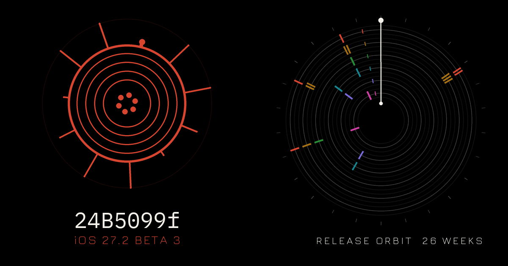
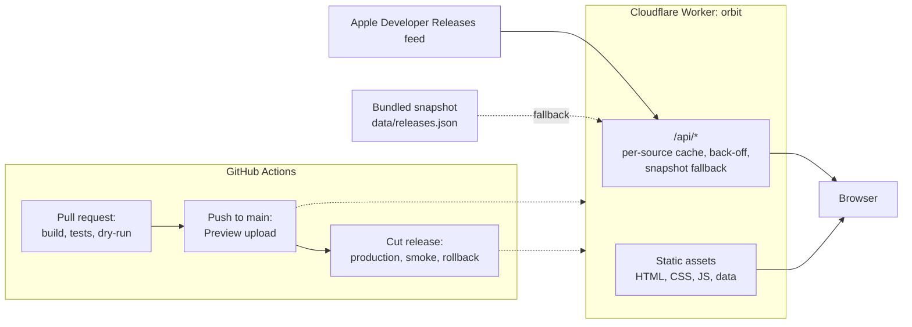

# Release Orbit

Every OS release, as it lands, with our own validation results, drawn as an orbit.

[](https://orbit.szolotov.com)

[](https://github.com/greenblacked/orbit/actions/workflows/ci.yml)
[](https://github.com/greenblacked/orbit/actions/workflows/security.yml)
[](https://github.com/greenblacked/orbit/actions/workflows/release.yml)
[](LICENSE)

Live site: <https://orbit.szolotov.com>. The `main` branch also uploads a Preview of the next release to <https://stage.orbit.szolotov.com>; that host sits behind Cloudflare Access and is for the owner only. The Preview has no `workers.dev` URL (`preview_urls` is `false` in `deploy/wrangler.json`); it needs `orbit.szolotov.com` attached to the Worker with Preview enabled. Until the first release, the stage job attaches it for Preview traffic only on its own; the first release makes it Production and Preview ([SETUP.md](SETUP.md)).

## What it does

- Shows the newest release or beta of each platform family, a timeline of everything released with platform and stage filters, and a side-by-side comparison of two releases.
- Follows Apple's six platform families, MikroTik RouterOS, Google Android, Microsoft Windows and Valve SteamOS (the Steam Deck) live. A family with no release in the data says "No release yet" instead of a made-up one ([ADR 0006](docs/adr/0006-list-vendors-before-their-feeds.md)).
- Draws the releases as a dial: one ring per platform, one notch per release placed by date, and a time machine that shows the site as of any day in the window.
- Gives every build a deterministic glyph, its sigil, so a build is recognisable at a glance ([docs/sigils.md](docs/sigils.md)).
- Publishes the outcome of testing each publicly released build, and only those.
- Works without JavaScript (placeholders and a link to the source), and falls back to a bundled snapshot when the live feed is unavailable.

## How it works

A Cloudflare Worker serves a static site and one small API. The API reads the vendor's public release feed, caches it per source, and falls back to a snapshot committed with the site. The browser draws everything from that data with plain JavaScript.



[docs/architecture.md](docs/architecture.md) describes the components, the data flow, what happens on each failure and the limits. The decisions behind the design are in [docs/adr/](docs/adr/0001-no-framework-or-bundler.md).

### Data contract

`/api/releases.json` (optionally `?vendor=apple`) answers one document, and `/api/health` reports each source.

`/api/security.json` answers the bundled security notes from `src/data/security.json` (schema 1; Apple and Android are the adapters, refreshed by `node deploy/snapshot_security.mjs`; the file stays empty until the first refresh, after the owner has checked the vendors' terms of use). The document holds `schema`, `generatedAt`, `sources`, `notes` (keyed by an `https` note URL, each with a `source` and its sorted `cves`) and `releases` (keyed by a release id from `releases.json`, each with a `status`, sorted `notes` and `cves`, and a `count`). A `status` is one of `listed`, `no-cve-entries`, `not-found`, `not-applicable`, `unavailable` or `not-connected`; only a `release` is ever `listed` or `no-cve-entries`, and every other release is `not-applicable`. `tests/security.test.mjs` is the executable contract; the reasoning is in [ADR 0008](docs/adr/0008-security-notes-are-a-separate-payload.md).

```json
{
  "source": "apple-developer-releases",
  "fetchedAt": "2026-10-11T15:26:54Z",
  "stale": false,
  "snapshot": false,
  "releases": [
    {
      "id": "https://developer.apple.com/news/releases/?id=10052026a",
      "vendor": "apple",
      "family": "iOS",
      "version": "27.2",
      "major": 27,
      "stage": "beta",
      "beta": 3,
      "build": "24B5099f",
      "title": "iOS 27.2 beta 3 (24B5099f)",
      "date": "2026-10-05T18:00:00Z",
      "url": "https://developer.apple.com/news/releases/?id=10052026a",
      "source": "apple-developer-releases"
    }
  ]
}
```

`stage` is `release`, `beta` or `rc`. `beta` is the iteration number of a beta or release candidate and null otherwise. `stale` is true when a failed refresh left an older copy in service, and `snapshot` is true when part of the answer is the bundled copy. A release may carry an optional `status` (`pass`, `warn` or `fail`); anything else, and any `status` on a beta or release candidate, is shown as untested.

### Validation results

`results/<vendor>/<family>/<build>.json` holds the outcome of testing one build. The schema is in [results/README.md](results/README.md) and `python scripts/check_results.py` enforces it.

Only results for publicly released builds (stage `release`) are committed or published, and the dial shows a `status` only on a released build. The validated files are copied to `/data/results/`; joining them to the releases on the dial is not wired yet, so every build reads as untested for now. A result for a beta or a release candidate is refused by the check, by CI and by the site build, so pre-release findings never reach the repository or the site. The reasoning is in [ADR 0005](docs/adr/0005-public-results-only-for-released-builds.md).

### Build sigils

A sigil is a glyph derived from a build string alone: the lead number sets the rings, the train letter the rotation and spoke lengths, the digits the spokes and the suffix the dots. The same build always draws the same sigil, and a build that is not in the Apple format is hashed into the same parameters. The rule, with worked examples, is in [docs/sigils.md](docs/sigils.md), and `tests/test_sigil_doc.py` keeps the document and `src/assets/sigil.js` in agreement.

## Quick start

```bash
python scripts/build_site.py --version local     # build dist/site
python scripts/check_site.py dist/site           # local links, fragments and the size budget
python -m pytest -m "not browser"                # build, pipeline, header and bundle tests
node --test 'tests/*.test.mjs'                  # parser, registry and Worker tests (Node 22)
python scripts/check_results.py                  # the validation results under results/
bash scripts/preview.sh                          # build, serve, smoke, screenshots, bundle
ruff check . && ruff format --check .            # when ruff is installed
```

The browser tests and the screenshots need Playwright and a Chromium:

```bash
python -m pip install --require-hashes -r .github/requirements/site-browser.txt
bash scripts/preview.sh --channel chrome         # or --executable PATH, or PLAYWRIGHT_BROWSERS_PATH
```

`scripts/preview.sh` builds the site, checks it, serves it on loopback with the production response headers, smoke-tests it and writes screenshots of every page at phone, tablet and desktop in the day, night and console themes. It also writes `dist/preview/index.html`, the whole site as one self-contained file for sharing as a private page. It fails on a console error, a CSP violation, a broken link or a page over budget.

To refresh the bundled snapshot, run `node deploy/snapshot_releases.mjs` and commit the result.

To refresh the security notes, run `node deploy/snapshot_releases.mjs` first and then `node deploy/snapshot_security.mjs`, and commit the result. The second reads each vendor's security index and the note page of every released build in `releases.json` that matches a row (one request a second, each page once), and writes only CVE ids, titles, dates and URLs to `src/data/security.json`. A vendor whose index cannot be read keeps its old data, is marked `failed` and makes the script exit non-zero. Apple and Android are driven so far (Android reads the AOSP build-numbers page for patch levels and one bulletin per month; the build-numbers page and up to 200 bulletins); the adapters are in `deploy/security/`. Where the vendors cannot be reached from your machine, run the **Security snapshot** workflow by hand (Actions, Run workflow) on a branch whose `src/data/releases.json` is current (refresh and merge that first; the workflow does not run `snapshot_releases.mjs`): it prints the file base64-encoded between two marker lines, with its size and SHA-256, in the job log. Download the raw log (`job.log`) and run `sed -n '/^[^ ]* -----BEGIN SECURITY JSON BASE64-----$/,/^[^ ]* -----END SECURITY JSON BASE64-----$/p' job.log | sed '1d;$d' | cut -d' ' -f2- | base64 -d > src/data/security.json && sha256sum src/data/security.json`, compare the digest with the logged `sha256:` and open a pull request. It commits nothing and holds no secret.

## Engineering standards

- **Performance budgets.** The scripts a page loads for first paint stay under 26,000 bytes gzipped (each script compressed alone at level 9, summed; about 20,800 today on the front page) and under 80,000 raw bytes, and the two lazily loaded effect modules are budgeted apart (`tests/test_site_data.py`). A page with everything it loads stays under 500,000 bytes and any image under 200,000 bytes (`scripts/check_site.py`). Effects load on idle, never from the HTML.
- **Accessibility.** One `h1` per page, landmarks, a working skip link, `alt` on every image, a name on every control, visible focus, controls of at least 44px and labels that contain their visible text. `tests/test_accessibility.py` audits every built page in a browser. Colour contrast of every family accent is held to WCAG AA in all three themes by `tests/test_palette.py`.
- **Security model.** A strict Content-Security-Policy with no inline script or style and no `unsafe-eval`, scripts only from the site's own origin and styles from it plus Google Fonts, the one outside origin, `frame-ancestors 'none'`, `nosniff`, a strict referrer policy and a permissions policy that turns the camera, microphone and geolocation off (`src/_headers`). The Worker may fetch only the URLs on each source's allowlist. The repository holds no secrets and a secret scan runs on every change. Every workflow sets minimal top-level permissions, every job a timeout, and every third-party action is pinned to a full commit SHA. Cloudflare credentials live in environment-scoped secrets: production's is reachable only from release tags. See [SECURITY.md](SECURITY.md).
- **Tests.** Python tests cover the build, the headers, the pipeline, the preview bundle and the browser behaviour; Node's own test runner covers the feed parser, the source registry, the Worker and the sigils. The site has no runtime dependency, and `scripts/` use the Python standard library only.

## Browser support and motion fallbacks

The site targets current evergreen browsers (Chrome, Edge, Firefox and Safari on desktop, iOS and Android) and degrades by feature detection, not by version.

- Without JavaScript, pages show placeholders and a link to the source.
- Scroll-driven effects run only where `animation-timeline` exists; elsewhere an `IntersectionObserver` only adds a class.
- Every transition and animation sits inside `prefers-reduced-motion: no-preference`, so reduced motion turns them all off, including the effects modules and the aurora.
- The WebGL aurora behind the hero is skipped under Save-Data, on four or fewer cores, without WebGL, or when its first second of frames is slow, and the CSS gradient stays.
- Time-machine controls work by pointer, touch and keyboard (arrow keys, Page Up and Page Down, Home and End).

## Release and rollback

Work lands on `dev` through pull requests, and `dev` is promoted to `main` with one pull request and a merge commit. A push to `main` uploads a Preview. A release is cut from `main` by running the **Cut release** workflow with a version such as `1.0.0`: it tags `v1.0.0`, and the **Release** workflow deploys production, smoke-tests it on `workers.dev` and rolls back automatically if a check fails.

To roll back by hand, from `deploy/` after `npm ci --ignore-scripts`, with `CLOUDFLARE_API_TOKEN` and `CLOUDFLARE_ACCOUNT_ID` set:

```bash
./node_modules/.bin/wrangler deployments list --config wrangler.json
./node_modules/.bin/wrangler rollback <version-id> --config wrangler.json --yes
```

The preferred rollback is a new patch release with the change reverted. The one-time Cloudflare and GitHub setup is in [SETUP.md](SETUP.md); the reasoning is in [ADR 0004](docs/adr/0004-dev-main-flow-with-tagged-releases.md).

## Project layout

```text
.
├── src/                   the site: pages, assets/, data/, _headers, og.png
│   ├── assets/            site.css, theme.js, site.js, releases.js, home.js,
│   │                      timeline.js, compare.js, sigil.js, orbit.js,
│   │                      sigil-generic.js, below.js, cadence.js, fx.js, aurora.js,
│   │                      security.js
│   └── data/              releases.json (snapshot), security.json, families.json, features.json
├── deploy/                the Worker (worker.js, releases.js, families.js,
│   ├── sources/           one adapter per feed), wrangler.json, snapshot_releases.mjs,
│   │                      snapshot_security.mjs
│   └── security/          security-notes adapters (snapshot step only: Apple, Android)
├── scripts/               build, checks, preview, screenshots and the source probe (standard library only)
├── results/               one JSON file per publicly released, tested build
├── tests/                 Python and Node tests, fixtures
├── docs/                  sigils.md, architecture.md, source-probe.md, adr/
└── .github/               workflows, issue and pull request templates, CODEOWNERS
```

Edit `src/` and `results/`. The header, footer, toast, Back bar and To top button are repeated on each page; change one on every page. A new page is a copy of an existing `src/<name>/index.html` with its head values changed, and the build adds it to the sitemap.

## Contributing

Read [CONTRIBUTING.md](CONTRIBUTING.md) for the flow, branch names and commit style, and [AGENTS.md](AGENTS.md) for the rules every change follows, including the preview loop. Branches are named `<type>/<kebab>` (for example `feat/contact-form`). Please follow the [Code of Conduct](CODE_OF_CONDUCT.md), and report a vulnerability privately as [SECURITY.md](SECURITY.md) describes.

## Licence

[MIT](LICENSE), copyright (c) 2026 Serhii Zolotov. The Contributor Covenant text in [CODE_OF_CONDUCT.md](CODE_OF_CONDUCT.md) is licensed under CC BY 4.0.

## Notice

Release Orbit is an independent project. It is not affiliated with, endorsed by or sponsored by Apple Inc., MikroTik, Google LLC, Microsoft Corporation, Valve Corporation or any other platform vendor. Apple, iOS, iPadOS, macOS, watchOS, tvOS, visionOS, MikroTik, RouterOS, Android, Windows, Steam, Steam Deck, SteamOS and other product names are trademarks of their respective owners and are used only to identify the software whose releases are listed. Release data comes from the vendors' public release pages, linked from every page of the site, and the descriptions are written in our own words.
